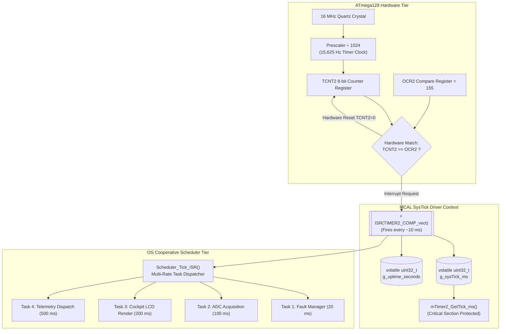
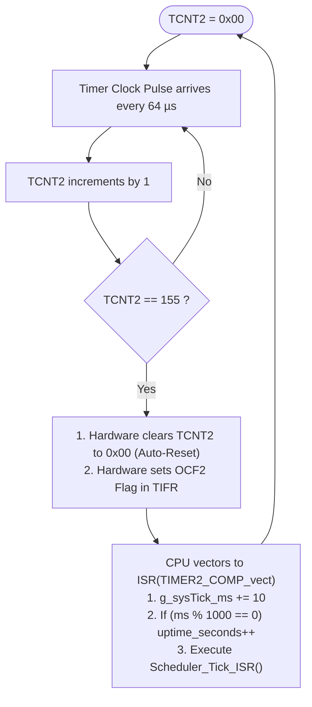
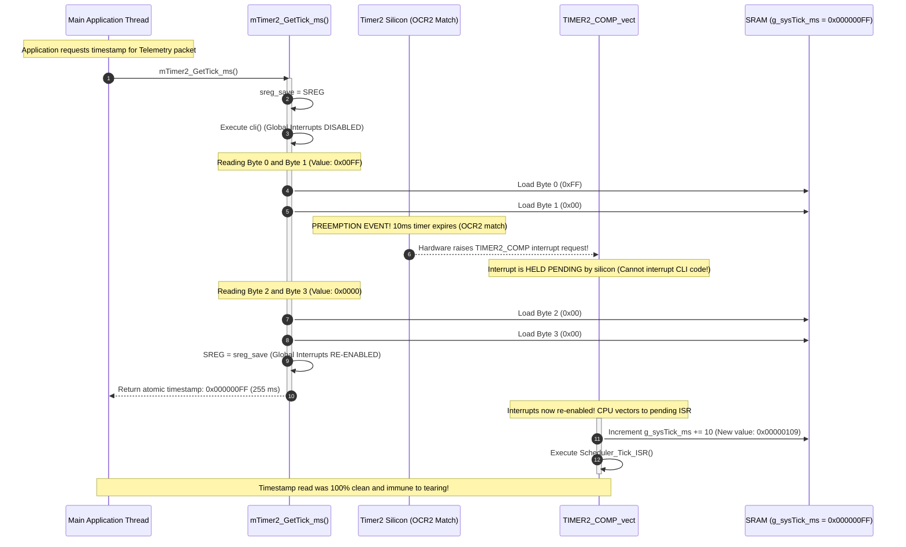
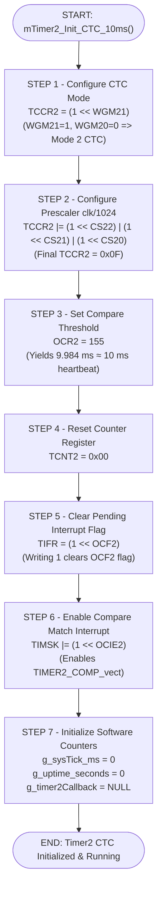
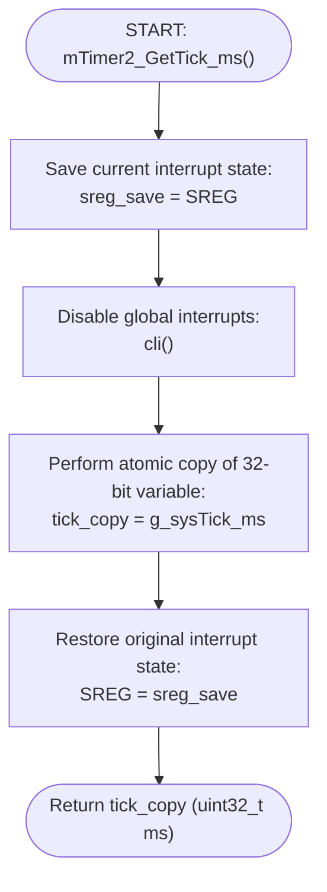
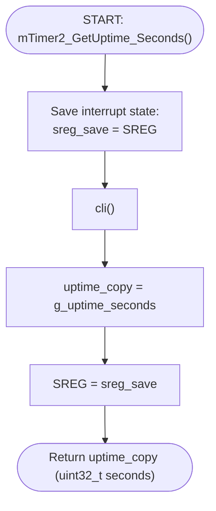
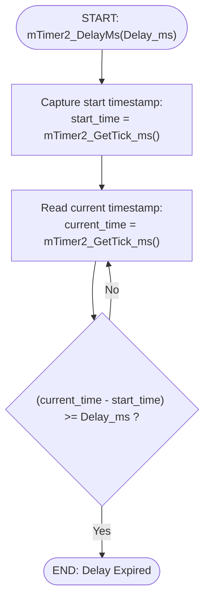
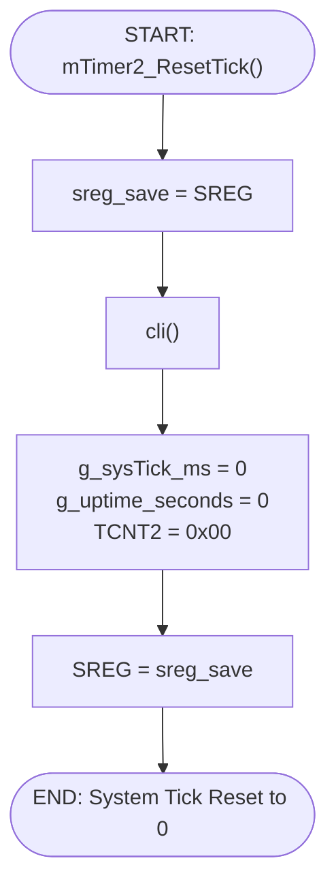
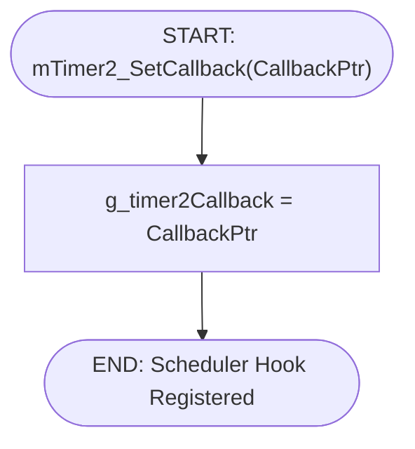
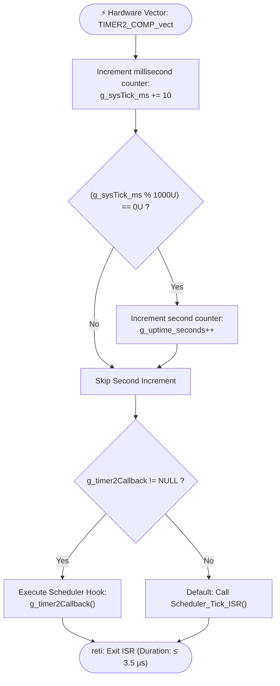

# US-005 — [MCAL] SysTick Timer Driver (Timer2 CTC 10ms Heartbeat)

**Document Type:** Technical User Story / Embedded Functional Specification  
**Project:** Gestell Automotive Mini-ECU  
**Target ECU:** Automotive Engine Control Unit (ATmega128 AVR @ 16 MHz)  
**Layer:** Microcontroller Abstraction Layer (MCAL)  
**Priority:** Critical (P0)  
**Story Points:** 5  

---

## 1. Textual Description

### 1.1 Objective & Role in Gestell Mini-ECU
The SysTick Timer Driver provides the foundational timebase and periodic execution heartbeat for the entire **Gestell Automotive Mini-ECU**. Leveraging the dedicated internal 8-bit **Timer/Counter2** peripheral in **Clear Timer on Compare Match (CTC)** mode, the driver generates a deterministic **$10\,\text{ms}$ periodic interrupt** ($100\,\text{Hz}$). This hardware pulse paces the cooperative OS scheduler, orchestrating multi-rate task dispatch across the entire vehicle firmware:
- **20 ms Task:** Fault Management, Diagnostic Trouble Code (DTC) evaluation, and emergency actuators.
- **100 ms Task:** Analog sensory acquisition (Engine Temperature via LM35, Battery Voltage via divider).
- **200 ms Task:** Vehicle Cockpit LCD Display frame rendering and dirty-line updates.
- **500 ms Task:** Dual wireless telemetry dispatch (Bluetooth HC-05 & Wi-Fi ESP-01).

### 1.2 Dedicated Hardware Allocation & Internal Clock Configuration
The SysTick driver is allocated exclusively to the internal 8-bit **Timer/Counter2** peripheral:
- **Clock Source:** Driven by the primary $16\,\text{MHz}$ system clock oscillator in synchronous mode (`ASSR = 0x00`, internal I/O clock `clk_I/O`).
- **Pin Isolation:** Output Compare pin `OC2` (`PB7`) is kept completely disconnected (`COM21:20 = 00` in `TCCR2`), ensuring all PORTB pins remain free for general I/O.
- **Operational Scope:** Operates purely as an internal periodic heartbeat counter, dedicated to firing the $10\,\text{ms}$ comparison interrupt.

### 1.3 Hardware Timing, CTC Frequency Math & 32-Bit Variable Tearing Protection
1. **Hardware CTC Mode Mechanics (`WGM21=1, WGM20=0`):**
   In CTC mode, the 8-bit counter register `TCNT2` increments on each prescaled clock pulse. When `TCNT2` equals the Compare Register `OCR2`, the internal silicon comparator automatically resets `TCNT2` to $0\text{x}00$ in hardware on the very next cycle and raises the `OCF2` interrupt flag. This hardware auto-reset guarantees **zero cycle slip** and eliminates software reload latency.
2. **Prescaler & Compare Register Mathematics:**
   The target scheduler frequency is $f_{\text{target}} = 100\,\text{Hz}$ ($T = 10.0\,\text{ms}$). Using prescaler $N = 1024$ (`CS22:20 = 111` in `TCCR2`):
   $$f_{\text{TCNT2}} = \frac{F_{\text{CPU}}}{N} = \frac{16,000,000\,\text{Hz}}{1024} = 15,625\,\text{Hz} \quad (T_{\text{tick}} = 64.0\,\mu\text{s})$$
   The required compare match value in `OCR2` is:
   $$\text{OCR2} = \frac{F_{\text{CPU}}}{N \times f_{\text{target}}} - 1 = \frac{16,000,000}{1024 \times 100} - 1 = 156.25 - 1 = 155.25 \approx 155$$
   - **Actual Period:**
     $$T_{\text{actual}} = \frac{1024 \times (155 + 1)}{16,000,000\,\text{Hz}} = \frac{159,744}{16,000,000} = 9.984\,\text{ms}$$
   - **Timing Accuracy:** The actual tick frequency is $100.16\,\text{Hz}$, representing an error of merely **$0.16\%$**, which is well within the strict $0.5\%$ automotive timing budget and eliminates accumulating drift.
3. **Protection Against 32-Bit Variable Tearing (Data Integrity):**
   The global tick counter is stored as a 32-bit unsigned integer (`uint32_t g_sysTick_ms`), providing an operational overflow horizon of **$49.7$ days** of continuous vehicle driving. Because the ATmega128 is an **8-bit microcontroller**, accessing a 32-bit variable requires **four consecutive CPU load instructions** (`lds r24`, `lds r25`, `lds r26`, `lds r27`).
   - *The Hazard:* If a Timer2 compare interrupt fires midway through loading (e.g., between byte 1 and byte 2) when the counter rolls over from `0x000000FF` to `0x00000100`, the main thread reads a corrupted hybrid value (`0x000001FF`), resulting in a catastrophic phantom forward jump of $256\,\text{ms}$.
   - *The Solution:* All reads to `g_sysTick_ms` are wrapped in an atomic critical section that saves the Status Register (`SREG`), disables global interrupts (`cli()`), copies the 32-bit value into a local buffer, and restores `SREG`. This guarantees **100% thread-safe atomic reads** with zero variable tearing.

---

## 2. Enums, Data Types & Function Prototypes

```c
/* =========================================================================
   TYPE DEFINITIONS & ENUMERATIONS
   ========================================================================= */

/**
 * @enum Timer2_Mode_t
 * @brief Timer2 operational waveform generation modes (TCCR2 bits WGM21:20).
 */
typedef enum {
    Timer2_Mode_Normal          = 0x00,  /* Normal 8-bit counter */
    Timer2_Mode_PhaseCorrectPWM = 0x40,  /* Phase Correct PWM */
    Timer2_Mode_CTC             = 0x08,  /* Clear Timer on Compare Match (Top = OCR2) */
    Timer2_Mode_FastPWM         = 0x48   /* Fast PWM (Top = 0xFF) */
} Timer2_Mode_t;

/**
 * @enum Timer2_Prescaler_t
 * @brief Timer2 clock prescaler division factors (TCCR2 bits CS22:20).
 */
typedef enum {
    Timer2_Prescaler_None = 0,  /* Timer stopped (No clock) */
    Timer2_Prescaler_1    = 1,  /* clk / 1 */
    Timer2_Prescaler_8    = 2,  /* clk / 8 */
    Timer2_Prescaler_32   = 3,  /* clk / 32 */
    Timer2_Prescaler_64   = 4,  /* clk / 64 */
    Timer2_Prescaler_128  = 5,  /* clk / 128 */
    Timer2_Prescaler_256  = 6,  /* clk / 256 */
    Timer2_Prescaler_1024 = 7   /* clk / 1024 (Nominal for 10ms SysTick) */
} Timer2_Prescaler_t;

/**
 * @enum Timer2_OC2_Mode_t
 * @brief Compare match output pin (OC2 / PB7) behavior (TCCR2 bits COM21:20).
 */
typedef enum {
    Timer2_OC2_Disconnected = 0x00,  /* Normal port operation, OC2 disconnected */
    Timer2_OC2_Toggle       = 0x10,  /* Toggle OC2 on compare match */
    Timer2_OC2_Clear        = 0x20,  /* Clear OC2 on compare match */
    Timer2_OC2_Set          = 0x30   /* Set OC2 on compare match */
} Timer2_OC2_Mode_t;

/**
 * @enum Timer2_Status_t
 * @brief Timer2 execution status codes.
 */
typedef enum {
    Timer2_Status_Ok    = 0,
    Timer2_Status_Error = 1
} Timer2_Status_t;

/**
 * @typedef Timer2_TickHook_t
 * @brief Function pointer prototype for 10ms OS scheduler tick hook.
 */
typedef void (*Timer2_TickHook_t)(void);

/* =========================================================================
   PUBLIC API PROTOTYPES
   ========================================================================= */

/**
 * @brief Initializes Timer2 in CTC mode with prescaler 1024 and OCR2=155.
 *        Enables Compare Match Interrupt (OCIE2) to generate 10ms heartbeats.
 */
void            mTimer2_Init_CTC_10ms(void);

/**
 * @brief Returns the system uptime in milliseconds since boot.
 *        Guaranteed 100% atomic (protected against 32-bit register tearing).
 * @return uint32_t Milliseconds elapsed since ECU power-on.
 */
uint32_t        mTimer2_GetTick_ms(void);

/**
 * @brief Returns the system uptime in complete seconds.
 *        Thread-safe atomic read wrapper.
 * @return uint32_t Seconds elapsed since ECU power-on.
 */
uint32_t        mTimer2_GetUptime_Seconds(void);

/**
 * @brief Non-drifting delay function based on SysTick timestamp comparison.
 *        Avoids timer slip and allows background ISR execution.
 * @param Delay_ms Milliseconds to wait.
 */
void            mTimer2_DelayMs(uint32_t Delay_ms);

/**
 * @brief Resets the tick counter to 0 (Used during ECU soft restart / sleep exit).
 */
void            mTimer2_ResetTick(void);

/**
 * @brief Registers a custom OS scheduler tick hook function invoked from ISR.
 * @param CallbackPtr Pointer to void(void) scheduler hook.
 */
void            mTimer2_SetCallback(Timer2_TickHook_t CallbackPtr);

#endif /* TIMER2_INTERFACE_H */
```

---

## 3. Architectural Diagrams & Visual Layout Descriptions

### 3.1 Hardware Interfacing & Multi-Rate Scheduler Pacing

#### Visual Layout Description:
The diagram illustrates how the ATmega128 hardware clock generates the 10ms periodic interrupt, and how the MCAL driver routes that heartbeat into the cooperative multi-rate OS scheduler:
1. **Left Section (MCU Clock & Counter Hardware):** The $16\,\text{MHz}$ quartz oscillator feeds the **$\div 1024$ Prescaler**, incrementing **`TCNT2`** every $64\,\mu\text{s}$. The hardware comparator tests against **`OCR2 = 155`**, auto-resetting `TCNT2` to $0$ on match.
2. **Middle Section (MCAL Driver Context):** The compare match triggers **`ISR(TIMER2_COMP_vect)`** every $9.984\,\text{ms}$, incrementing `volatile uint32_t g_sysTick_ms` by $10$ and managing the 1-second uptime counter. The atomic API `mTimer2_GetTick_ms()` protects 32-bit reads.
3. **Right Section (Cooperative OS Scheduler):** The ISR triggers `Scheduler_Tick_ISR()`, which decrements software task countdown timers to dispatch the $20\,\text{ms}$ Safety Task, $100\,\text{ms}$ ADC Task, $200\,\text{ms}$ LCD Task, and $500\,\text{ms}$ Telemetry Task.



---

### 3.2 CTC Waveform & Auto-Reset State Machine

#### Visual Layout Description:
The flowchart demonstrates the continuous, hardware-driven cycle of Timer2 in CTC mode:
1. **Counting:** `TCNT2` starts at $0\text{x}00$ and increments by $1$ every $64\,\mu\text{s}$ ($15,625\,\text{Hz}$).
2. **Comparison:** Hardware comparator continuously evaluates `TCNT2 == 155`.
3. **Compare Match Action:** At count $155$, silicon hardware simultaneously resets `TCNT2 = 0x00` and asserts the `OCF2` interrupt flag in `TIFR`.
4. **ISR Execution:** The CPU vectors to `TIMER2_COMP_vect`, increments `g_sysTick_ms += 10`, evaluates the 1-second uptime rollover, calls the scheduler hook, and resumes main execution.



---

### 3.3 Atomic Critical Section Protection vs. Interrupt Collision

#### Visual Layout Description:
The sequence diagram demonstrates how the critical section protects a 32-bit timestamp read from being corrupted when a 10ms hardware timer interrupt collides with the CPU read instruction sequence:
1. **Application Call:** Main super-loop calls `mTimer2_GetTick_ms()` to timestamp a telemetry packet.
2. **Critical Section Entry:** Driver saves `SREG` into a local variable and executes `cli()` to disable global interrupts.
3. **Partial Read:** CPU loads Byte 0 and Byte 1 from SRAM.
4. **Interrupt Collision:** While Byte 2 is about to be read, Timer2 hardware reaches `OCR2=155` and raises an interrupt request. The silicon holds the interrupt **pending** because global interrupts are disabled.
5. **Read Completion & Exit:** CPU safely loads Byte 2 and Byte 3 without data tearing. `SREG` is restored, re-enabling global interrupts.
6. **Deferred Execution:** The CPU immediately branches to the pending `TIMER2_COMP_vect` ISR. The main application receives a 100% valid, uncorrupted 32-bit timestamp.



---

## 4. Function-Level Pseudo-Code & Internal Design

> **Execution Model Decision:**  
> This driver uses **periodic hardware interrupt execution** ($10\,\text{ms}$ interval) with an **ultra-lightweight ISR budget ($\le 4\,\mu\text{s}$)**.  
> At $100\,\text{Hz}$, a $4\,\mu\text{s}$ ISR consumes strictly **$0.04\%$ of total CPU bandwidth**, guaranteeing that $99.96\%$ of processing power remains available for application tasks and communication stacks.

---

### 4.1 `mTimer2_Init_CTC_10ms()` — Peripheral Initialization

#### Description:
The one-time startup sequence called during ECU boot. It configures Timer2 for CTC mode, sets prescaler to $\div 1024$, loads `OCR2 = 155`, clears the counter register `TCNT2`, flushes any pending compare match flags, and unmasks the `OCIE2` interrupt bit in `TIMSK`.

#### Pseudo-Code Flowchart:



---

### 4.2 `mTimer2_GetTick_ms()` — Atomic 32-Bit Millisecond Read

#### Description:
Provides thread-safe access to the 32-bit millisecond counter. Because loading a 32-bit integer on an 8-bit architecture requires 4 distinct assembly instructions, the function wraps the copy operation inside a critical section that preserves the CPU interrupt state (`SREG`), preventing data tearing.

#### Pseudo-Code Flowchart:



---

### 4.3 `mTimer2_GetUptime_Seconds()` — Atomic Uptime Query

#### Description:
Provides thread-safe access to the 32-bit cumulative seconds counter (`g_uptime_seconds`), used by diagnostics and telemetry packets. Utilizes identical critical section protection to eliminate variable tearing.

#### Pseudo-Code Flowchart:



---

### 4.4 `mTimer2_DelayMs()` — Non-Drifting SysTick Busy-Wait

#### Description:
A non-drifting millisecond delay function based on continuous comparison against the atomic system tick. Unlike naive CPU instruction delay loops (`_delay_ms`), this implementation does not freeze background interrupts and does not slip when preemption occurs.

#### Pseudo-Code Flowchart:



---

### 4.5 `mTimer2_ResetTick()` — Tick Reset / Resynchronization

#### Description:
Resets the tick counter to $0$ inside a critical section. Used during ECU soft-reboot, sleep mode exit, or system state resynchronization.

#### Pseudo-Code Flowchart:



---

### 4.6 `mTimer2_SetCallback()` — Scheduler Tick Hook Registration

#### Description:
Allows higher software layers (OS Cooperative Scheduler) to attach a custom callback function pointer that is invoked on every single 10ms interrupt tick.

#### Pseudo-Code Flowchart:



---

### 4.7 `ISR(TIMER2_COMP_vect)` — Hardware Compare Match Interrupt Handler

#### Description:
The core periodic interrupt handler executed by the ATmega128 CPU every $9.984\,\text{ms}$. It performs three deterministic operations:
1. Increments `g_sysTick_ms += 10`.
2. Evaluates the 1-second rollover: if `(g_sysTick_ms % 1000 == 0)`, increments `g_uptime_seconds++`.
3. Invokes the registered scheduler hook (`Scheduler_Tick_ISR()`) or user callback to dispatch ready tasks.
Total execution duration is strictly **$\le 3.5\,\mu\text{s}$ ($\le 56$ CPU clock cycles)**.

#### Pseudo-Code Flowchart:



---

## 5. Acceptance Criteria (DoD)

- [ ] **AC-1 (Tick Frequency Precision):** Timer2 generates periodic Compare Match interrupts at strictly $100.16\,\text{Hz} \pm 0.5\%$ ($9.984\,\text{ms} \approx 10\,\text{ms}$ period), verified on an oscilloscope by toggling a test GPIO in the ISR.
- [ ] **AC-2 (Atomic 32-Bit Monotonicity):** 10,000,000 rapid concurrent calls to `mTimer2_GetTick_ms()` produce strictly monotonic non-decreasing integers with zero backward jumps or 32-bit register tear corruptions.
- [ ] **AC-3 (Hardware CTC Auto-Reset):** `TCNT2` resets to $0\text{x}00$ strictly via internal hardware comparator logic without software register writes.
- [ ] **AC-4 (Sub-4µs ISR Execution Duration):** Total execution time of `ISR(TIMER2_COMP_vect)` from vector entry to `reti` does not exceed $4.0\,\mu\text{s}$ ($\le 64$ CPU clock cycles @ 16 MHz).
- [ ] **AC-5 (Scheduler Hook Execution):** Every single 10ms interrupt triggers the registered scheduler tick hook without omission or dropped pulses.
- [ ] **AC-6 (Long-Term Drift Performance):** Cumulative timing drift over 1 hour of continuous execution does not exceed $0.2\%$ ($\le 7.2\,\text{seconds}$ over 1 hour).
- [ ] **AC-7 (Non-Drifting Delay Accuracy):** `mTimer2_DelayMs(100)` pauses execution for exactly $100.0\,\text{ms} \pm 1.0\,\text{ms}$ while allowing all higher-priority ISRs to execute without distortion.
- [ ] **AC-8 (Zero Dynamic Memory Allocation):** The SysTick driver allocates strictly zero bytes of dynamic heap memory (`malloc`/`free`); all state variables reside in static BSS memory.

