# US-004 — [MCAL] External Interrupt (EXTI) Driver

**Document Type:** Technical User Story / Embedded Functional Specification  
**Project:** Gestell Automotive Mini-ECU  
**Target ECU:** Automotive Engine Control Unit (ATmega128 AVR @ 16 MHz)  
**Layer:** Microcontroller Abstraction Layer (MCAL)  
**Priority:** Critical (P0)  
**Story Points:** 5  

---

## 1. Textual Description

### 1.1 Objective & Role in Gestell Mini-ECU
The External Interrupt (EXTI) Driver provides low-level control of the asynchronous external interrupt hardware lines of the **ATmega128** (`INT4` and `INT5`). In the Gestell Automotive Mini-ECU architecture, these two physical interrupt lines are dedicated to capturing real-time human operator inputs from the vehicle cockpit:
- **Ignition Push-Button (`INT4` on `PE4`):** Commands engine state transitions between `OFF`, `START`, and `RUN`.
- **Fault Reset Push-Button (`INT5` on `PE5`):** Requests clearance of active Diagnostic Trouble Codes (DTCs) and recovers the ECU from `SAFE_MODE` once operational conditions stabilize.

The driver guarantees instant, deterministic capture of asynchronous button events with **sub-2-microsecond ISR execution latency**, eliminating CPU polling overhead and protecting the cooperative OS scheduler from interrupt starvation.

### 1.2 Dedicated ECU Hardware Mapping & Cockpit Button Matrix
The driver interfaces with the physical input circuit mapped in the Gestell Mini-ECU hardware schematic:

- **Ignition Switch (`PE4` / `INT4`):**
  - **Pin:** `GroupE Pin4` (`PE4` — alternate function `INT4`).
  - **Electrical Configuration:** Normally-Open (NO) momentary push-button connected between `PE4` and Chassis Ground (`GND`).
  - **Bias:** Internal pull-up resistor ($30\,\text{k}\Omega \dots 50\,\text{k}\Omega$) activated via the DIO driver (`US-001`). Pin idles at $+5.0\,\text{V}$ (`HIGH`).
  - **Trigger Characteristic:** **Falling Edge** ($+5\,\text{V} \to 0\,\text{V}$) on button press.
- **Fault Reset Switch (`PE5` / `INT5`):**
  - **Pin:** `GroupE Pin5` (`PE5` — alternate function `INT5`).
  - **Electrical Configuration:** Normally-Open (NO) momentary push-button connected between `PE5` and Chassis Ground (`GND`).
  - **Bias:** Internal pull-up resistor ($30\,\text{k}\Omega \dots 50\,\text{k}\Omega$) activated via the DIO driver (`US-001`). Pin idles at $+5.0\,\text{V}$ (`HIGH`).
  - **Trigger Characteristic:** **Falling Edge** ($+5\,\text{V} \to 0\,\text{V}$) on button press.

### 1.3 Asynchronous Edge Detection, Preemption & Sub-2µs ISR Mechanics
Mechanical switches exhibit severe physical contact bounce (chattering) lasting **$5\,\text{ms} \dots 20\,\text{ms}$**, producing dozens of rapid electrical edges per press. To prevent system lockup and state machine corruption, the EXTI driver implements a decoupled architecture:

1. **Edge-Triggered Silicon Sensing (`EICRB`):**
   Interrupts are configured strictly for **Falling Edge Detection** (`ISC41:40 = 10` and `ISC51:50 = 10`). Rebound bounces occurring while the button remains physically depressed at ground level are suppressed.
2. **Sub-2-Microsecond Ultra-Fast ISR ($O(1)$ Execution):**
   The interrupt service routine performs strictly two atomic operations:
   - Sets a `volatile bool` pending event flag (`g_ignitionEventPending = true` or `g_resetEventPending = true`).
   - Invokes an optional lightweight user callback pointer (if registered).
   - Executes `reti` in strictly **$\le 18$ CPU clock cycles** ($1.125\,\mu\text{s}$ at $16\,\text{MHz}$).
   - **Zero Fat ISRs:** Calling delay functions (`_delay_ms`), blocking loops, UART sends, or display writes inside the ISR is strictly prohibited.
3. **Decoupled 20ms Software Debounce (Hand-off to OS Scheduler):**
   Contact debounce validation is completely offloaded to the cooperative OS scheduler. The scheduler inspects the latched flag at its $10\,\text{ms}$ periodic tick and verifies that the physical pin remains `LOW` across **two consecutive ticks ($20\,\text{ms}$)** before dispatching the validated event to the ECU State Machine.
4. **Spurious Interrupt Guard (Pre-Clearance Protocol):**
   Prior to enabling interrupts in `EIMSK`, the driver writes a logical `1` to bits `INTF4` and `INTF5` in the `EIFR` register. This flushes any stale flags latched during power-up or pin configuration, guaranteeing zero false triggers during boot.

---

## 2. Enums, Data Types & Function Prototypes

```c
/* =========================================================================
   TYPE DEFINITIONS & ENUMERATIONS
   ========================================================================= */

/**
 * @enum EXTI_Line_t
 * @brief External Interrupt physical lines on ATmega128.
 */
typedef enum {
    EXTI_Line_INT4 = 4,  /* PE4: Cockpit Ignition Push-Button */
    EXTI_Line_INT5 = 5   /* PE5: Cockpit Fault Reset Push-Button */
} EXTI_Line_t;

/**
 * @enum EXTI_SenseControl_t
 * @brief Interrupt sense control modes (EICRB bits ISC4x / ISC5x).
 */
typedef enum {
    EXTI_Sense_LowLevel    = 0x00,  /* The low level of pin generates an interrupt */
                                                          /* 0x01 is Reserved  */
    EXTI_Sense_FallingEdge = 0x02,  /* Falling edge generates an interrupt (Default) */
    EXTI_Sense_RisingEdge  = 0x03   /* Rising edge generates an interrupt */
} EXTI_SenseControl_t;

/**
 * @enum EXTI_Status_t
 * @brief EXTI operation return status codes.
 */
typedef enum {
    EXTI_Status_Ok    = 0,
    EXTI_Status_Error = 1
} EXTI_Status_t;

/**
 * @typedef EXTI_Callback_t
 * @brief Function pointer prototype for asynchronous ISR callbacks.
 */
typedef void (*EXTI_Callback_t)(void);

/* =========================================================================
   PUBLIC API PROTOTYPES
   ========================================================================= */

/**
 * @brief Initializes INT4 and INT5 for Falling-Edge triggering.
 *        Configures EICRB, clears pending EIFR flags, and enables EIMSK masks.
 */
void            mEXTI_Init(void);

/**
 * @brief Enables hardware interrupt request for the specified line (INT4 or INT5).
 *        Pre-clears pending flag before unmasking.
 * @param Line Interrupt line index (EXTI_Line_INT4 or EXTI_Line_INT5).
 */
void            mEXTI_EnableLine(uint8_t Line);

/**
 * @brief Disables hardware interrupt request for the specified line.
 * @param Line Interrupt line index (EXTI_Line_INT4 or EXTI_Line_INT5).
 */
void            mEXTI_DisableLine(uint8_t Line);

/**
 * @brief Configures trigger sense control (Falling, Rising, etc.) for a line.
 * @param Line      Interrupt line index.
 * @param SenseMode Trigger sensitivity mode (EXTI_SenseControl_t).
 */
void            mEXTI_SetSenseControl(uint8_t Line, uint8_t SenseMode);

/**
 * @brief Manually clears the hardware interrupt flag in EIFR.
 * @param Line Interrupt line index.
 */
void            mEXTI_ClearPendingFlag(uint8_t Line);

/**
 * @brief Queries whether an Ignition button press was latched by INT4 ISR.
 * @return bool true if an event occurred, false otherwise.
 */
bool            mEXTI_GetIgnitionFlag(void);

/**
 * @brief Atomically clears the latched Ignition button event flag.
 */
void            mEXTI_ClearIgnitionFlag(void);

/**
 * @brief Queries whether a Fault Reset button press was latched by INT5 ISR.
 * @return bool true if a reset event occurred, false otherwise.
 */
bool            mEXTI_GetResetFlag(void);

/**
 * @brief Atomically clears the latched Fault Reset button event flag.
 */
void            mEXTI_ClearResetFlag(void);

/**
 * @brief Registers a user callback function to execute directly within the ISR context.
 * @param Line        Interrupt line index (EXTI_Line_INT4 or EXTI_Line_INT5).
 * @param CallbackPtr Pointer to user void(void) callback function.
 */
void            mEXTI_SetCallback(uint8_t Line, EXTI_Callback_t CallbackPtr);

#endif /* EXTI_INTERFACE_H */
```

---

## 3. Architectural Diagrams & Visual Layout Descriptions

### 3.1 Hardware Interfacing & Cockpit Push-Button Circuit

#### Visual Layout Description:
The diagram illustrates the physical and electrical path from cockpit momentary switches into the ATmega128 microcontroller core:
1. **Left Section (Cockpit Switch Tier):** Shows the physical **Ignition Push-Button** and **Fault Reset Push-Button** connected to Ground, biased by internal $30\,\text{k}\Omega$ pull-up resistors to maintain a $+5\,\text{V}$ idle level.
2. **Middle Section (MCU Peripheral Hardware):** Displays input pins `PE4` and `PE5` routing into the **Edge Detection Logic (`EICRB`)**, which tests against falling-edge criteria. Upon edge match, the signal asserts flags in the **Interrupt Controller (`EIFR` & `EIMSK`)**.
3. **Right Section (MCAL ISR & Shared Storage):** Shows the interrupt controller vectoring the CPU to `ISR(INT4_vect)` and `ISR(INT5_vect)`, which immediately latch into **`volatile bool` Event Flags** without blocking or CPU delay.

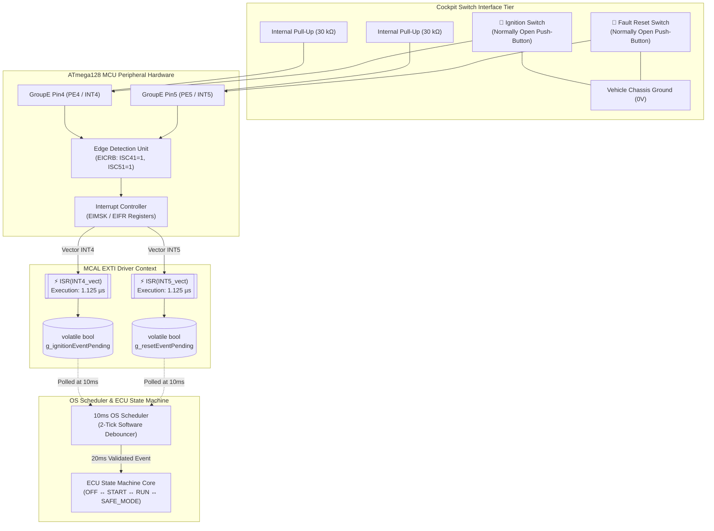

---

### 3.2 State Diagram: Interrupt Event Latching & Decoupled 20ms Debounce Cycle

#### Visual Layout Description:
The state diagram shows the complete lifecycle of a physical button press from initial edge strike through mechanical chatter to final state machine validation:
1. **IDLE State:** Pin held `HIGH` by internal pull-up. Flag is `false`.
2. **ISR_LATCH State:** Falling edge triggers interrupt. The ISR executes in $1.125\,\mu\text{s}$, latches the volatile flag to `true`, and returns immediately.
3. **DEBOUNCE_WAIT State:** The 10ms scheduler samples the pin across two successive ticks ($20\,\text{ms}$ total elapsed time) while mechanical contact bounce settles.
4. **VALIDATED vs DISCARDED:** If the pin remains `LOW` at the 20ms mark, the event is confirmed and posted to the ECU State Machine. If the pin returned `HIGH`, the event is classified as noise and safely discarded.

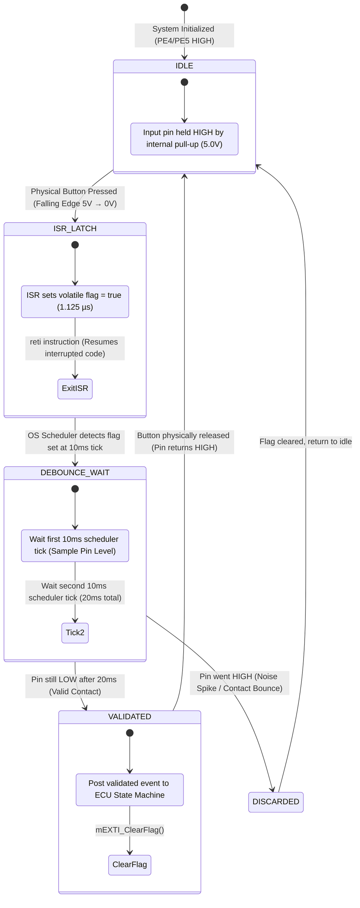

---

### 3.3 Asynchronous Preemption & Timeline Sequence Diagram

#### Visual Layout Description:
The sequence diagram details the microsecond-by-microsecond interaction when a physical button press preempts the main CPU execution thread:
1. **Preemption:** While the main super-loop is executing lower-priority tasks (e.g., updating the LCD display), the operator presses the Ignition button.
2. **ISR Execution:** The hardware halts the super-loop, vectors to `ISR(INT4_vect)`, sets `g_ignitionEventPending = true`, and returns in **$18$ clock cycles ($1.125\,\mu\text{s}$)**. The CPU immediately resumes the LCD task.
3. **Chatter Absorption:** Switch contacts bounce for $4\,\text{ms}$. Because the interrupt latched the initial transition, chatter is completely harmless.
4. **Scheduler Debounce:** The 10ms scheduler samples the pin at Tick 1 and Tick 2 ($20\,\text{ms}$). Once debounced, it clears the flag and dispatches the `IGNITION_TOGGLE` event to the State Machine.

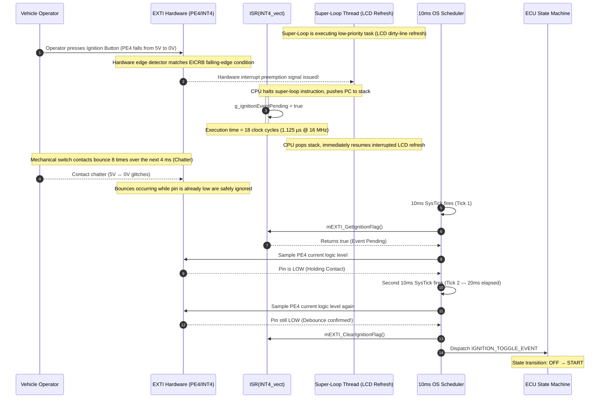

---

## 4. Function-Level Pseudo-Code & Internal Design

> **Execution Model Decision:**  
> This driver uses **ultra-fast asynchronous ISR execution ($< 2\,\mu\text{s}$)** coupled with **volatile flag latching**.  
> The ISR contains zero loops, zero delays, and zero state machine logic.  
> Debouncing is completely delegated to the 10ms OS Scheduler.  
> This guarantees **zero jitter** on system timers and prevents interrupt starvation across the entire ECU.

---

### 4.1 `mEXTI_Init()` — Peripheral Initialization

#### Description:
The one-time startup sequence called during ECU boot before enabling global interrupts (`sei()`). It configures `EICRB` for falling-edge detection on both `INT4` and `INT5`, writes logical `1` to `EIFR` to flush any pending stale flags, enables the interrupt masks in `EIMSK`, and initializes the volatile event flags to `false`.

#### Pseudo-Code Flowchart:

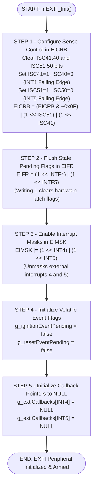

---

### 4.2 `mEXTI_SetSenseControl()` — Sensitivity Configuration

#### Description:
Configures the edge or level trigger mode for the specified external interrupt line. For `INT4` through `INT7`, it performs a Read-Modify-Write (RMW) on `EICRB` without disturbing the configuration of adjacent interrupt channels.

#### Pseudo-Code Flowchart:

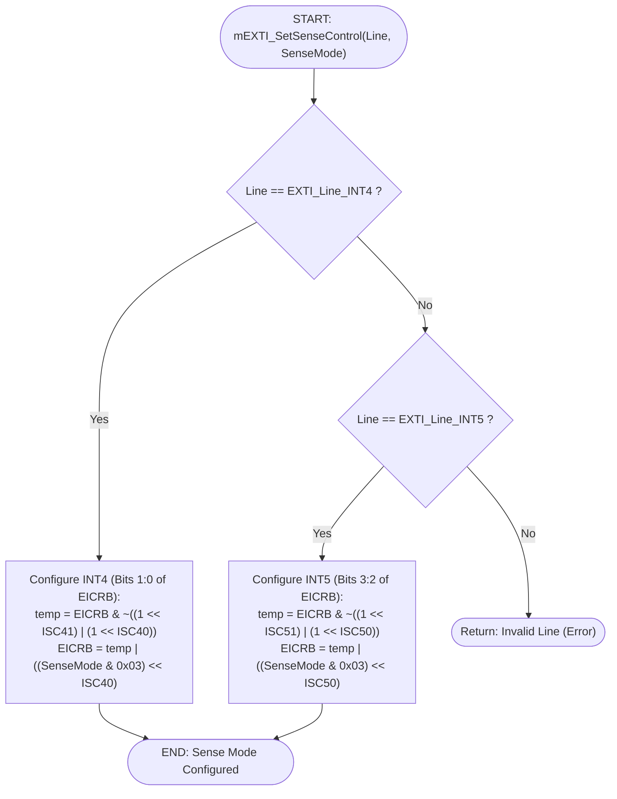

---

### 4.3 `mEXTI_EnableLine()` / `mEXTI_DisableLine()` — Channel Masking

#### Description:
Enables or disables individual interrupt lines in the `EIMSK` register. When enabling, it always flushes any stale flag in `EIFR` first to prevent executing an interrupt that was latched while the channel was disabled.

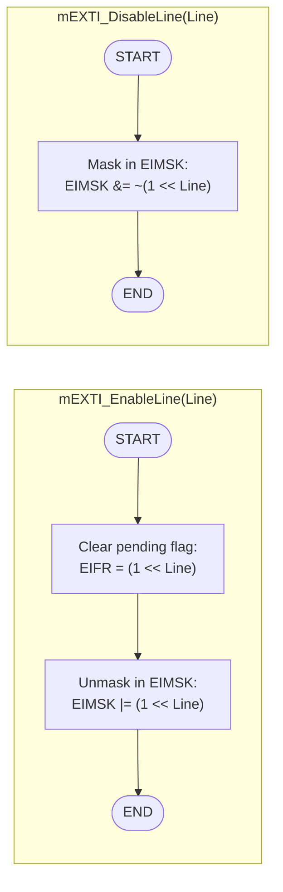

---

### 4.4 `mEXTI_ClearPendingFlag()` — Hardware Flag Reset

#### Description:
Manually clears the hardware flag in `EIFR`. In the AVR architecture, writing a logical `1` to a flag bit clears it. Writing `0` leaves it untouched.

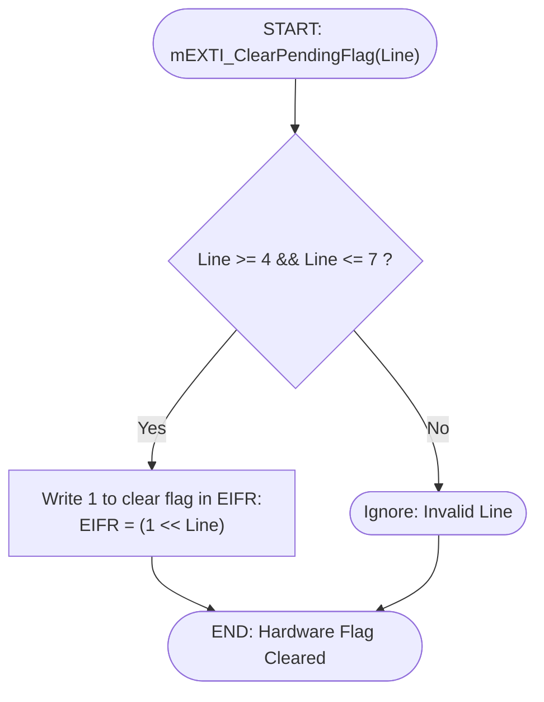

---

### 4.5 `mEXTI_GetIgnitionFlag()` & `mEXTI_ClearIgnitionFlag()` — Ignition Accessors

#### Description:
Provides thread-safe access to the volatile boolean ignition event flag. Reading is a single 8-bit memory load ($O(1)$ atomic on 8-bit AVR). Clearing sets the flag to `false`.

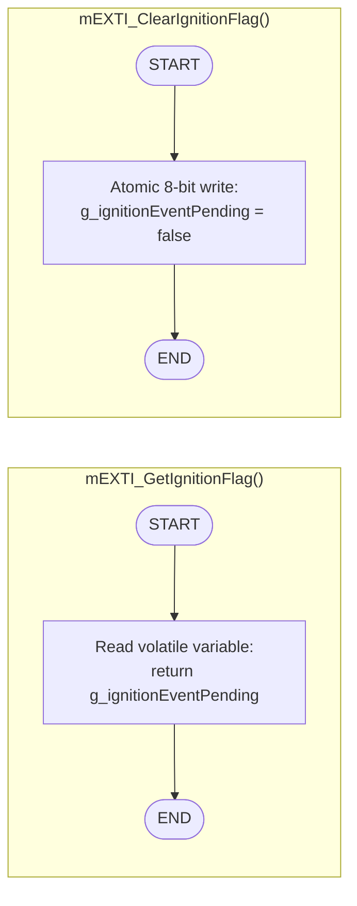

---

### 4.6 `mEXTI_GetResetFlag()` & `mEXTI_ClearResetFlag()` — Fault Reset Accessors

#### Description:
Provides thread-safe access to the volatile boolean fault reset event flag.

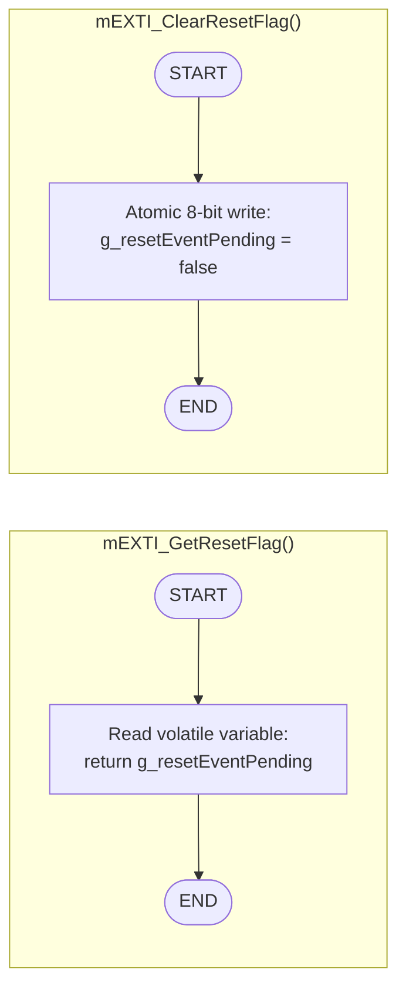

---

### 4.7 `mEXTI_SetCallback()` — User ISR Callback Registration

#### Description:
Registers an optional application-level callback function that will be executed directly inside the ISR context when the interrupt triggers. The callback pointer must be initialized to `NULL` at startup.

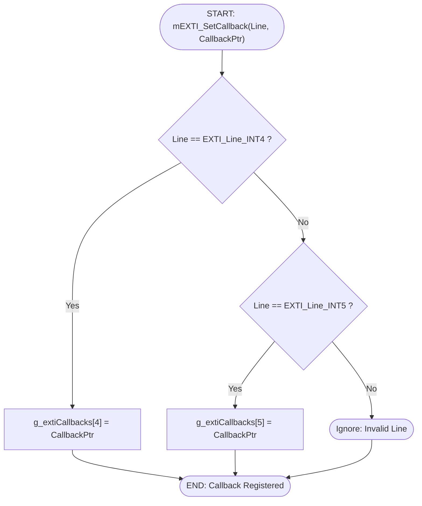

---

### 4.8 `ISR(INT4_vect)` & `ISR(INT5_vect)` — Hardware Interrupt Service Handlers

#### Description:
The hardware interrupt routines executed by the ATmega128 CPU when falling edges are detected on `PE4` and `PE5`. They strictly set the respective volatile boolean flag, invoke the user callback if registered, and exit immediately. Total execution time is strictly **$\le 1.125\,\mu\text{s}$ ($\le 18$ CPU cycles)**.

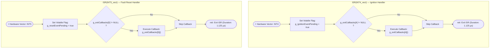

---

## 5. Acceptance Criteria (DoD)

- [ ] **AC-1 (Edge Detection Accuracy):** The EXTI driver reliably detects falling edges on pins `PE4` (Ignition) and `PE5` (Fault Reset) when connected to active-low momentary push-buttons.
- [ ] **AC-2 (Sub-2µs ISR Duration):** `ISR(INT4_vect)` and `ISR(INT5_vect)` execute from entry to `reti` in $\le 2.0\,\mu\text{s}$ ($\le 32$ CPU clock cycles @ 16 MHz), verified via simulator cycle counter or oscilloscope pin toggle.
- [ ] **AC-3 (Spurious Flag Prevention):** Initializing via `mEXTI_Init()` or calling `mEXTI_EnableLine()` flushes `EIFR` and does not fire false interrupt triggers from pre-existing hardware flags.
- [ ] **AC-4 (Thread-Safe Event Clearing):** Calling `mEXTI_ClearIgnitionFlag()` or `mEXTI_ClearResetFlag()` clears the event latch atomically without race conditions or side effects on adjacent variables.
- [ ] **AC-5 (Zero Contamination in MCAL):** The EXTI driver files contain zero software debounce loops, zero blocking delays (`_delay_ms`), and zero ECU State Machine logic.
- [ ] **AC-6 (Channel Independence):** Enabling or disabling `INT4` does not alter or corrupt the configuration or mask status of `INT5` in `EIMSK` and `EICRB`.
- [ ] **AC-7 (Callback Invocation Safety):** If a user callback is registered via `mEXTI_SetCallback()`, it is invoked inside the ISR; if `NULL`, it is skipped cleanly without invalid pointer dereferencing.
- [ ] **AC-8 (Pull-Up Electrical Integrity):** Both `PE4` and `PE5` are verified to maintain $+5.0\,\text{V} \pm 5\%$ idle levels when physical buttons are open, confirming active internal pull-ups.

